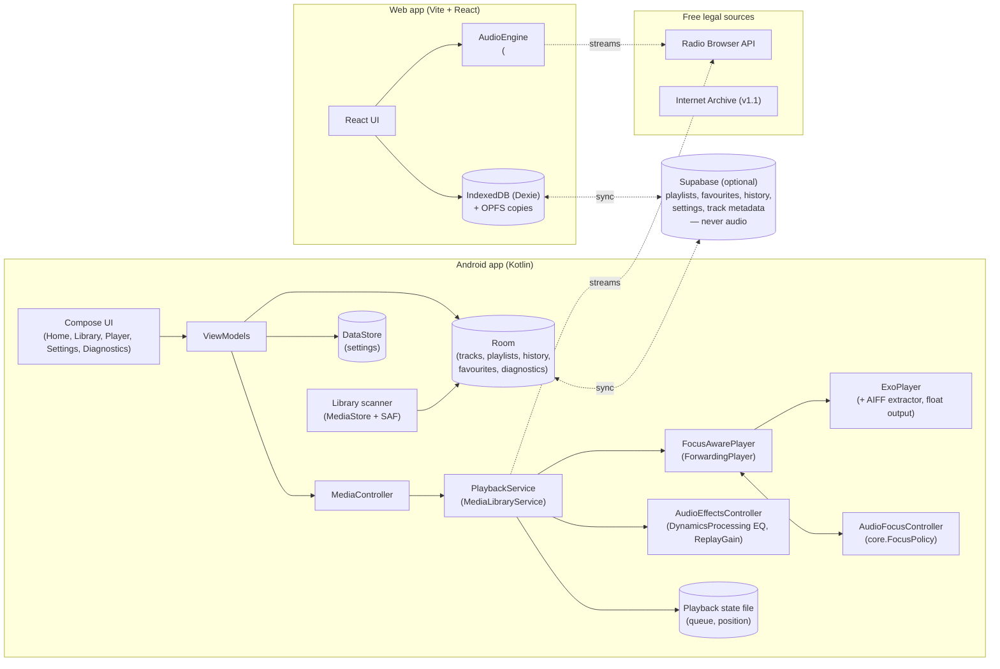

# Architecture

**Unpaused** is an ad-free, local-first music player for Android (native) and
the web (companion). It aims to stay playing as reliably as Android allows.

* Research behind each decision: [`docs/research/`](research/README.md)
* Plan and v1 scope: [`ROADMAP.md`](ROADMAP.md)

## 1. Decisions (and what would change them)

| Decision | Why | What would flip it |
|---|---|---|
| **Independent player: local files + free legal streaming.** No premium-service integrations. | No major service offers official full-track playback to third-party players without partner approval, a paid subscription or DRM SDKs. Amazon's API is a closed beta. ([02](research/02-music-providers.md)) | An official, publicly available playback API from Amazon or TIDAL. |
| **Own audio-focus policy with three modes (Standard / Smart / Mix)** on top of Media3, instead of Media3's built-in focus handling. | Media3's built-in handling always pauses for ever on a permanent loss and exposes no raw focus events, so we couldn't log or tune it. ([01](research/01-android-interruptions.md)) | Media3 adding configurable focus policies plus event callbacks. |
| **Media3 `MediaLibraryService`** (a `MediaSessionService` with a browse tree). | Foreground-service lifecycle, notification, lock screen, headset buttons, and playback resumption including the System UI resumption card. Google also names it the safe path under Android 17's background-audio hardening. | — |
| **Pure-Kotlin `:core` module** for the decision logic: focus policy, ReplayGain, quality labels, AIFF parsing, LRC, track keys, sync merge. | Unit-testable on a plain JVM, with no device or emulator. The same rules are mirrored in TypeScript and checked by the **shared test vectors** in `shared/test-vectors/`. | — |
| **No Hilt**; a small hand-written `AppContainer`. | Two modules and about a dozen singletons don't need a DI framework. Less annotation processing means faster and less fragile CI. | Growing beyond ~5 modules. |
| **Room + DataStore** | As requested; Room FTS4 for search. | — |
| **Vite + React + TS** for the web, not Next.js. | There's no server-side work. A static SPA hosts free and avoids server rendering of browser-only APIs. ([04](research/04-web-platform.md)) | Needing server routes, e.g. a proxy. |
| **Supabase (optional) + JSON export/import** for sync. | Open source, plain REST, RLS, and a publishable key that is safe in clients. JSON bundles work with no account at all. ([05](research/05-sync-and-costs.md)) | — |
| **GPL-3.0-or-later** licence. | Keeps GPL decoders (e.g. FFmpeg builds) possible later. All current dependencies are Apache-2.0, MIT or OFL, which are compatible. | — |

## 2. System overview



## 3. Android

### Modules

```
android/
├─ core/   Kotlin/JVM — no Android dependencies, JUnit tests
│   focus/        FocusPolicy state machine (Standard, Smart, Mix)
│   audio/        ReplayGain, AudioQuality (lossless/lossy labels), dB math
│   aiff/         AIFF/AIFF-C header parser
│   lyrics/       LRC parser + line lookup
│   library/      TrackKey normalisation, sort keys
│   sync/         Last-writer-wins merge with tombstones
│   diagnostics/  Interruption classifier (expected vs unexpected)
└─ app/    Android application
    playback/     PlaybackService, FocusAwarePlayer, AudioFocusController,
                  AudioEffectsController, PlaybackStateStore, SleepTimer,
                  AiffExtractor, OutputInfo
    data/         Room DB + DAOs, scanners, repositories, Radio Browser client,
                  Supabase sync client, settings (DataStore)
    ui/           design system (theme, dot-matrix components), screens, nav
```

### Playback path

```
UI / notification / lock screen / headset / Bluetooth
          │ (MediaController / media buttons)
          ▼
 MediaLibrarySession ──► FocusAwarePlayer (ForwardingPlayer)
                              │  play():  FocusPolicy decides → request focus?
                              │  focus events → pause / duck / resume
                              ▼
                         ExoPlayer (handleAudioFocus = false)
                              │  extractors: Media3 defaults + AiffExtractor
                              │  renderers: MediaCodec audio, float output for >16-bit
                              ▼
                         AudioTrack (session id fixed per service)
                              │  session effects: DynamicsProcessing (EQ,
                              │  bass/treble, ReplayGain boost, limiter)
                              ▼
                         Android mixer → speaker / USB / Bluetooth
```

### The focus policy (`core/focus`)

A pure state machine. **Inputs:** user play/pause, focus changes, audio-mode
changes (calls), "other audio active" checks, ticks, noisy events, and the
foreground-service window closing. **Outputs:** commands such as
`RequestFocus`, `AbandonFocus`, `Pause(reason)`, `Play(reason)`,
`SetVolume(multiplier)`, `ScheduleCheck(ms)` and `Log(event)`. The Android
adapter (`AudioFocusController`) only translates between platform callbacks and
these types, so every rule in
[01 §4](research/01-android-interruptions.md#4-focus-modes-implemented) is
covered by JVM unit tests.

### Recovery

* **Process killed:** queue, index, position, shuffle and repeat go to a small
  file. They are written every 5 s while playing and on every pause, track
  change and `onTaskRemoved`. On restart the UI restores the queue (paused),
  and `onPlaybackResumption` serves Bluetooth and System UI resume requests.
* **Reboot:** System UI asks for resumption metadata with
  `isForPlayback = false` and shows the resume card. Pressing play restores and
  plays.
* A "was playing when the process died" flag is logged to Diagnostics, so a
  kill by the system is visible.

## 4. Web

```
web/src
├─ lib/db        Dexie schema (tracks, playlists, favourites, history, files, settings)
├─ lib/import    file/folder import, music-metadata parsing, artwork thumbnails
├─ lib/audio     AudioEngine (two <audio> elements, Web Audio graph), AIFF→WAV,
│                ReplayGain, quality labels, Media Session
├─ lib/sources   Radio Browser client
├─ lib/sync      Supabase REST client + LWW merge (mirrors core/sync)
├─ state         small store (queue, player state)
└─ ui            design system + screens
```

## 5. Shared

* `shared/design-tokens.json`: colours, type scale, spacing and motion, used by
  both apps.
* `shared/sync-schema.md` + `backend/supabase/migrations/*.sql`: one data model.
* `shared/test-vectors/*.json`: fixtures that both the Kotlin and the
  TypeScript tests must pass (track keys, ReplayGain, LRC, quality labels,
  merge).

## 6. Technology stack (versions checked 27 Nov 2026)

| Layer | Choice |
|---|---|
| Android build | Gradle 9.7.1, AGP 9.5.0 (built-in Kotlin), Kotlin 2.4.21, KSP 2.3.14, JDK 21 (CI) |
| Android SDK | compileSdk 37, targetSdk 36, minSdk 26 |
| Playback | AndroidX Media3 1.11.1 (exoplayer, session, inspector) |
| UI | Jetpack Compose (BOM 2026.11.01, Material 3 1.5.0), Navigation Compose 2.10.2, Coil 3.6.3 |
| Data | Room 2.8.5, DataStore 1.3.0, WorkManager 2.12.0, kotlinx-serialization 1.13.0, OkHttp 5.5.1, coroutines 1.11.0 |
| Android tests | JUnit 4, Robolectric 4.18.1, AndroidX Test; instrumented focus tests on an emulator in CI |
| Web | Vite 8, React 19, TypeScript, Tailwind CSS 4, Dexie 4, music-metadata 13, Vitest 5, Playwright |
| Backend (optional) | Supabase free tier (Postgres + RLS + email OTP auth) |
| CI/CD | GitHub Actions: APK build + tests, a release with the APK; web tests + GitHub Pages deploy |
| Fonts (OFL) | Geist, Geist Mono, Doto (dot-matrix accents). No Nothing fonts or assets are used. |
